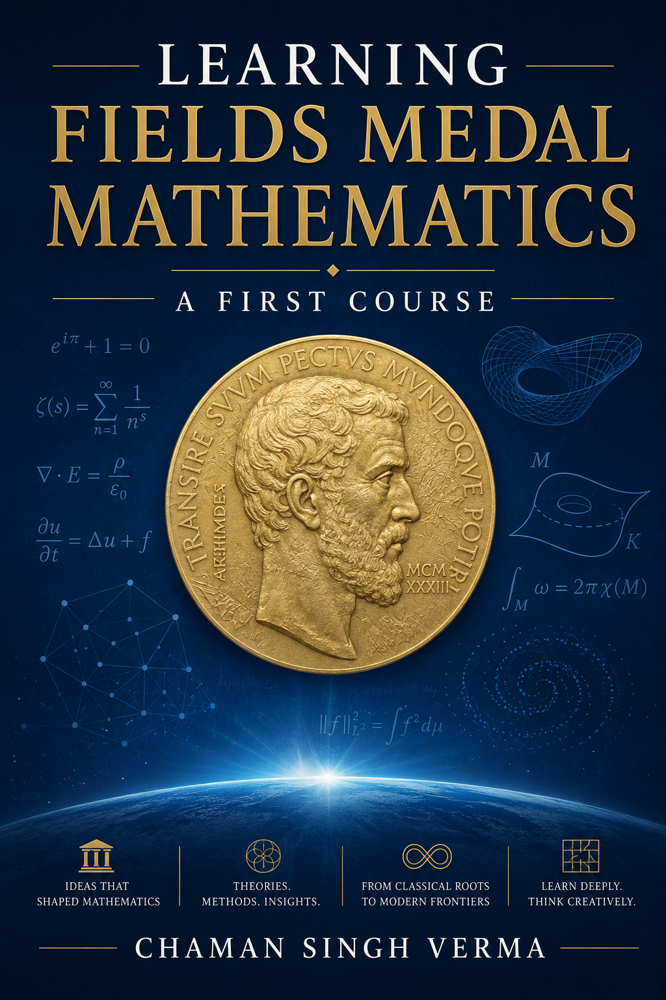

# Learning Fields Medal Mathematics: A First Course

<p align="center">
  
</p>

A comprehensive, accessible introduction to modern mathematics through the work of every Fields Medalist from 1936 to 2022. Written for undergraduate mathematics students, this book bridges the gap between textbook mathematics and cutting-edge research by presenting the ideas behind the most prestigious award in mathematics.

## About the Book

The Fields Medal, often called the "Nobel Prize of Mathematics," is awarded every four years by the International Mathematical Union to up to four mathematicians under the age of 40. Each medalist's work represents a profound advance in mathematical thought.

This book profiles **64 Fields Medalists** across **1,721 pages**, covering:

- **Biographical context** — the mathematician's background, education, and career
- **Mathematical contributions** — the theorems, conjectures, and frameworks that led to the award
- **Key results** — stated precisely with context for the reader
- **Impact** — how the work connects to broader themes in mathematics
- **References** — pointers to original papers and further reading

## Medalists Covered

| Year | Medalists |
|------|-----------|
| 1936 | Jesse Douglas, Lars Ahlfors |
| 1950 | Atle Selberg, Laurent Schwartz |
| 1954 | Jean-Pierre Serre, Kunihiko Kodaira |
| 1958 | Klaus Roth, Rene Thom |
| 1962 | John Milnor, Lars Hormander |
| 1966 | Alexander Grothendieck, Michael Atiyah, Paul Cohen, Stephen Smale |
| 1970 | Alan Baker, Heisuke Hironaka, John Thompson, Sergei Novikov |
| 1974 | David Mumford, Enrico Bombieri |
| 1978 | Charles Fefferman, Daniel Quillen, Gregori Margulis, Pierre Deligne |
| 1982 | Alain Connes, Shing-Tung Yau, William Thurston |
| 1986 | Gerd Faltings, Michael Freedman, Simon Donaldson |
| 1990 | Edward Witten, Shigefumi Mori, Vaughan Jones, Vladimir Drinfeld |
| 1994 | Efim Zelmanov, Jean Bourgain, Jean-Christophe Yoccoz, Pierre-Louis Lions |
| 1998 | Curtis McMullen, Maxim Kontsevich, Richard Borcherds, Timothy Gowers |
| 2002 | Laurent Lafforgue, Vladimir Voevodsky |
| 2006 | Andrei Okounkov, Grigori Perelman (declined), Terence Tao, Wendelin Werner |
| 2010 | Cedric Villani, Elon Lindenstrauss, Ngo Bao Chau, Stanislav Smirnov |
| 2014 | Artur Avila, Manjul Bhargava, Martin Hairer, Maryam Mirzakhani |
| 2018 | Akshay Venkatesh, Alessio Figalli, Caucher Birkar, Peter Scholze |
| 2022 | Hugo Duminil-Copin, James Maynard, June Huh, Maryna Viazovska |

## Building from Source

### Prerequisites

- A LaTeX distribution (TeX Live, MiKTeX, or MacTeX)
- `pdflatex` compiler

### Compile

```bash
pdflatex -interaction=nonstopmode field_medals.tex
pdflatex -interaction=nonstopmode field_medals.tex
```

Two passes are required for cross-references and table of contents.

A pre-built PDF is available in the repository root: [`field_medals.pdf`](field_medals.pdf)

## Repository Structure

```
.
├── field_medals.tex          # Main LaTeX file
├── field_medals.pdf          # Compiled book (1,721 pages)
├── frontpage.png             # Cover image
├── chapters/                 # Individual chapter files
│   ├── chapter_1936_jesse_douglas.tex
│   ├── chapter_1936_lars_valerian_ahlfors.tex
│   ├── ...
│   └── chapter_2022_maryna_viazovska.tex
└── fields_medalists.txt      # List of all medalists
```

## Target Audience

- **Undergraduate mathematics students** seeking exposure to research-level ideas
- **Instructors** looking for supplementary reading for courses in analysis, algebra, topology, or number theory
- **Anyone** interested in understanding what modern mathematics looks like beyond the textbook

## License

This book is compiled from publicly available sources for educational purposes.

## Contributing

Contributions are welcome. Please open an issue or submit a pull request for:

- Corrections to mathematical content or historical facts
- Improved exposition or accessibility
- Missing references or outdated citations
